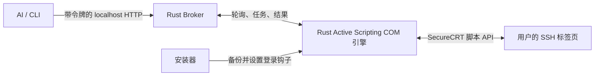

# SecureCRT Bridge

让 AI 使用你已经登录的 SecureCRT SSH 标签页。你继续使用原来的终端，AI 通过本机接口读取屏幕、发送命令并获取结果；命令和输出也会出现在同一个窗口里。

适合由堡垒机客户端唤起 SecureCRT 的工作流。无需把远程密码交给 AI，也无需另外建立 SSH 连接。

## 能做什么

- **共用终端**：保留 SecureCRT 界面和原登录链路，支持读取屏幕、执行 POSIX shell 命令、获取输出和退出码。
- **后台多会话**：窗口可最小化；每个标签页有独立 ID，不同标签页可以并行，同一标签页的 AI 写入串行处理。
- **自动接入**：安装后配置登录钩子；新连接、重新连接时自动接入。本地服务可随 Windows 登录启动。
- **常规安装界面**：自动查找路径、手动浏览目录、安装／升级／卸载切换、进度条和逐步执行日志。
- **跨 AI 会话使用**：安装用户级 `securecrt-bridge` skill，其他 Codex 对话可发现安装路径与现有终端。
- **可暂停、可恢复**：托盘控制暂停与退出，安装前备份配置，卸载按记录恢复，保留用户后续修改。

## 下载与安装

在 [Releases](https://github.com/LinHuiG/securecrt-bridge/releases) 下载 `SecureCRTBridge-0.1.5-Setup.exe`。

1. 关闭 SecureCRT。
2. 双击安装包，确认 **SecureCRT 安装目录** 和 **配置目录**。找不到时使用“浏览…”；配置目录应包含 `Sessions/Default.ini`。
3. 点击“开始安装 / 升级”，等待进度到 100%。
4. 像平常一样从堡垒机连接 SSH，或打开 SecureCRT 会话。

要求：**Windows x64、SecureCRT x64**。已在 SecureCRT 9.7.1 上验证。产品由 Rust 编译，安装 EXE 内置接入 DLL，无需另装 Python、Node 或 Rust。SecureCRT 本身不包含在安装包中。

桥接程序安装到所选 SecureCRT 目录的 `SecureCRTBridge` 子目录；数据与备份位于 `%USERPROFILE%\AppData\Local\SecureCRTBridge`。注册与启动项属于当前 Windows 用户。安装目录需要当前用户有写权限；不会自动提升权限。

升级时重新运行新版安装包。卸载可在同一界面选择“卸载桥接”，也可从 Windows 已安装应用进入。建议使用独立安装包卸载，避免正在运行的安装目录 EXE 被占用。原始配置备份会保留。

## 使用

AI 加载 [skill](assets/skill/SKILL.md) 后，会先列出会话、核对屏幕与目标，再申请写入租约。也可以直接使用 CLI：

```powershell
$install = Get-Content "$env:USERPROFILE\AppData\Local\SecureCRTBridge\installation.json" -Raw | ConvertFrom-Json
$scb = Join-Path $install.install_dir 'securecrt-bridge.exe'

& $scb sessions | Out-String
& $scb screen SESSION_ID | Out-String
& $scb claim SESSION_ID --owner my-task | Out-String
& $scb exec SESSION_ID --owner my-task --command 'hostname; pwd' --timeout 15 | Out-String
& $scb release SESSION_ID --owner my-task | Out-String
```

GUI 子系统 EXE 在 PowerShell 中建议接 `| Out-String`，确保等待结束并收集输出。复杂命令用 `--file UTF8_FILE` 或 `--stdin`，避免多层引号转义。

`exec` 要求终端处于空闲的 POSIX shell 提示符。命令在 `sh -c` 子 shell 中运行，不改变父 shell 的目录或环境；需要目录上下文时写成 `cd /path && ...`。交互式程序可用 `input`，但它只发送输入，不自动判断执行完成。

## 技术方案



- **Native engine**：实现 Active Scripting COM 接口，使用独立 ProgID `SecureCRTBridge.Native`。SecureCRT 登录脚本载入它后，保留 `crt.GetScriptTab()` 的实际标签页对象；终端调用始终留在宿主脚本线程。
- **Broker**：仅监听 `127.0.0.1`，为每个标签页维护状态、写入租约和请求 ID。AI 可并行使用不同会话，不依赖窗口焦点或标签页顺序。
- **结果采集**：把命令包在开始／结束标记之间，使用 `Screen.ReadString` 获取输出和退出码。标记在发送字符串中拆开，避免误匹配终端命令回显。
- **显示处理**：空闲时关闭同步缓冲，让用户窗口持续刷新；采集期间使用同步读取，所有退出路径恢复显示。
- **安装器**：原生 Win32 控件加工作线程。文件写入、配置备份、COM 注册、启动项设置和服务启动通过进度事件更新窗口。
- **恢复记录**：记录修改前后的配置值和自有文件哈希；卸载只还原仍保持安装值的条目，保留用户修改过的文件与配置。

目录：

```text
crates/core     HTTP、会话调度、租约、请求去重、配置备份与恢复
crates/engine   Active Scripting COM 引擎与终端采集
crates/app      安装界面、服务、CLI、托盘、隔离诊断程序
assets/skill    AI 使用说明
```

## 边界与可靠性

- 这是**同一个终端**，用户键盘输入不会被租约锁住。人和 AI 应轮流操作同一标签页。
- 本机令牌保护所有 API；拒绝带 Origin 的浏览器请求。令牌不提供隔离同一 Windows 用户下恶意程序的能力。不要分享或提交 `connection.json`。
- 每次写入先生成请求 ID。超时或断线时先查询 `result REQUEST_ID`，不得凭超时判断“没执行”并重发。
- 请求去重与结果记录属于当前服务生命周期，不是跨重启的 exactly-once 保证。未知结果会保持会话占用，确认 shell 已空闲后才能 `acknowledge`。
- 命令最多等待 300 秒，结果上限 1 MiB；普通历史输出约 30 分钟后清理，未确认的未知结果需显式处理。暂停取消未派发任务，不会中断已经在服务器运行的命令。
- 现有内置 Python 或不支持的登录脚本会跳过，保留原设置。ActiveX 脚本串联已实现，但尚未覆盖第三方脚本实测。显式 `/SCRIPT` 启动参数会覆盖默认登录钩子。
- 安装器不会绕过堡垒机认证、SecureCRT 许可或 AI 所在环境的权限限制。

## 构建与测试

推荐 Windows x64 Rust MSVC 工具链及 Visual Studio C++ Build Tools：

```powershell
.\build.ps1 test
.\build.ps1 release
```

先构建 DLL，再把 DLL 内嵌进 EXE，产物为 `target/release/securecrt-bridge.exe`。使用锁定依赖；已有缓存可加 `-Offline`。MSVC 和 GNU 配置均静态链接 CRT。

GNU 工具链需要 MinGW 的 `windres`、`dlltool`、`as` 与链接器。非标准路径可传 `-ToolchainRoot <Rust工具链目录> -BinutilsDirectory <MinGW的bin目录>`。这些工具仅用于开发，不是用户运行依赖。

自动测试覆盖认证 HTTP、分段网络请求、租约隔离、重复派发防护、超时保留、配置选择性恢复、COM 生命周期及延时输出。真实会话验证与安装器验证范围见 [验证记录](docs/VALIDATION.md)。

## 许可

[MIT](LICENSE)。本项目与 VanDyke Software、齐治均无隶属关系，不分发 SecureCRT 或堡垒机客户端。依赖说明见 [THIRD_PARTY_NOTICES.md](THIRD_PARTY_NOTICES.md)。